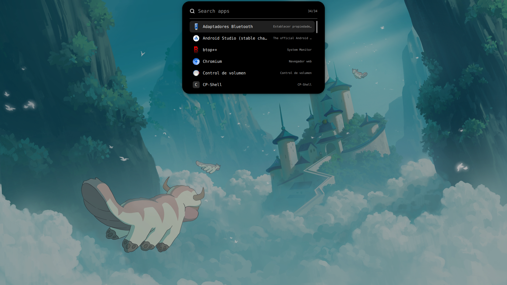
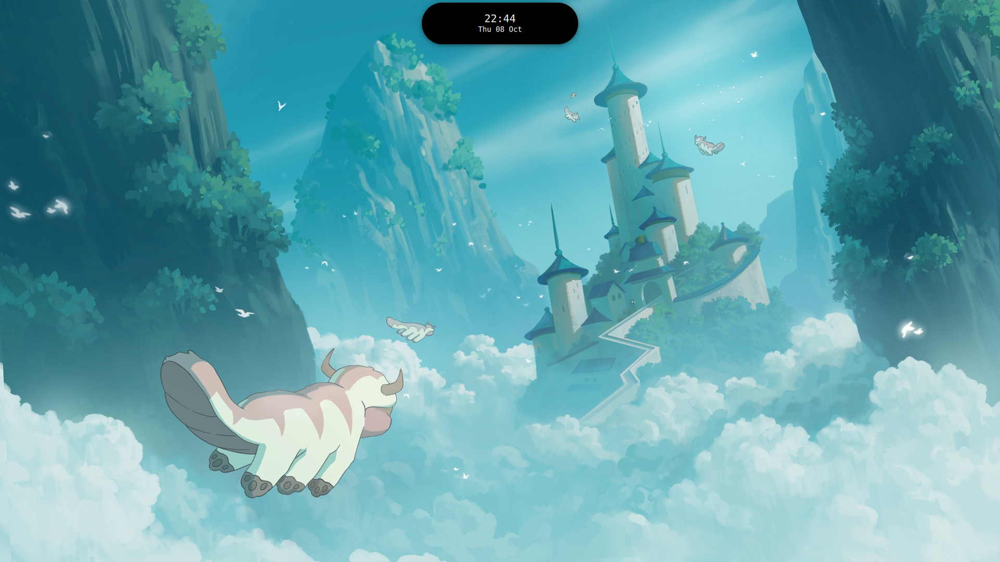
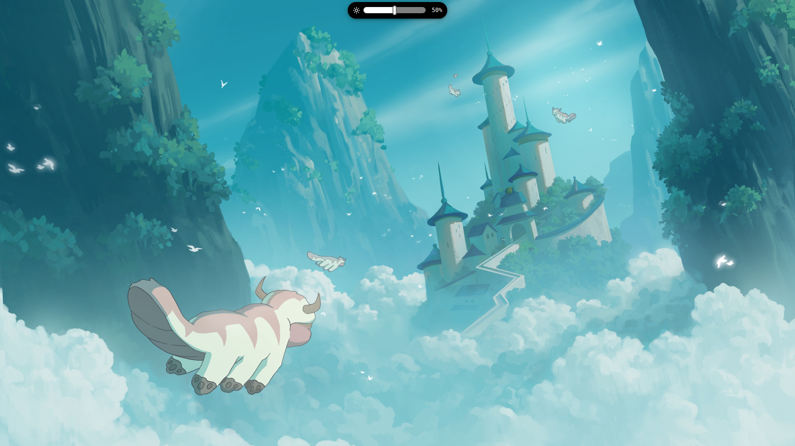
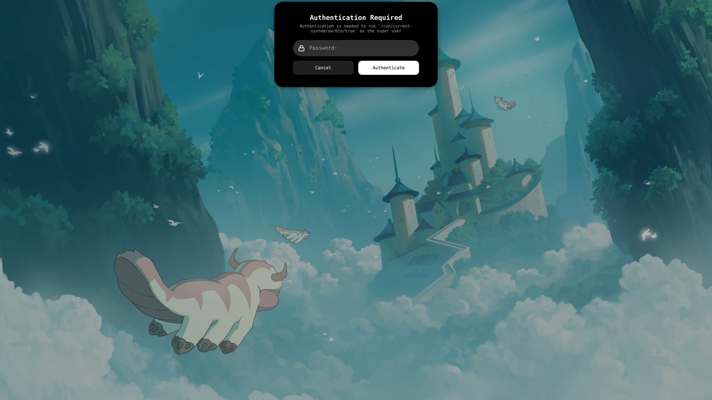
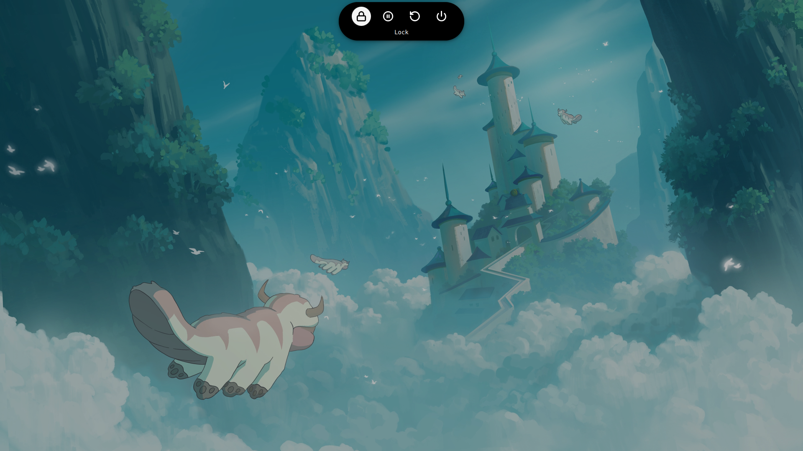
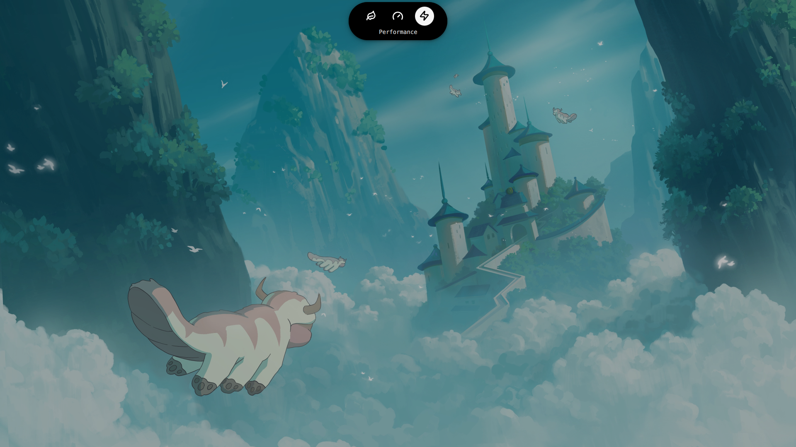

<div align="center">

# DIBAR

### A dynamic island bar built with Quickshell for Hyprland

DIBAR morphs between compact views for system controls, search,
authentication, and desktop feedback.

<p>
  
  
  
  
</p>

<p>
  <a href="#features">Features</a> ·
  <a href="#quick-start">Quick start</a> ·
  <a href="#recommended-bindings">Bindings</a> ·
  <a href="#gallery">Gallery</a> ·
  <a href="#documentation">Documentation</a>
</p>



<sub>Inspired by <strong>@saneAspect</strong> and <strong>@Gakuseei</strong>.</sub>

</div>

## Features

<table>
  <tr>
    <td width="50%">
      <strong>System controls</strong><br>
      PipeWire volume up to 150%, mute state, contextual laptop brightness,
      and external DDC/CI display control.
    </td>
    <td width="50%">
      <strong>Search and clipboard</strong><br>
      Native desktop-entry search plus cliphist text history, image previews,
      filtering, restoration, and deletion.
    </td>
  </tr>
  <tr>
    <td width="50%">
      <strong>Session and power</strong><br>
      Lock, suspend, restart, power off, and reactive power-profile selection.
    </td>
    <td width="50%">
      <strong>Desktop integration</strong><br>
      PolicyKit authentication, workspace feedback, battery state, focus
      restoration, and multi-monitor modal behavior.
    </td>
  </tr>
</table>

Every view follows the same compact visual language and uses sequential
content → shape → content transitions.

## Quick start

Place the project in your Quickshell configuration directory and run:

```bash
qs -p ~/.config/quickshell/shell.qml
```

> [!IMPORTANT]
> DIBAR includes its own graphical PolicyKit agent. Disable other agents such
> as `hyprpolkitagent` before starting it.

<details>
<summary><strong>Requirements</strong></summary>

- Quickshell 0.3 or newer with PipeWire, UPower, Hyprland, Wayland, and
  PolicyKit support.
- PipeWire.
- `brightnessctl`.
- `ddcutil` for external-monitor brightness.
- `power-profiles-daemon`.
- `cliphist` and `wl-clipboard`.
- A PolicyKit daemon.
- A terminal emulator for desktop entries marked as terminal applications
  (Ghostty by default).

</details>

For clipboard watchers, PolicyKit, DDC/CI, and dependency notes, see
[Setup and system integration](docs/SETUP.md).

Common behavior such as workspace feedback, terminal command, maximum volume,
and brightness step can be changed in `Config/Settings.qml`.

## Recommended bindings

The following examples use Hyprland's Lua configuration:

```lua
hl.bind(mainMod .. " + R",
    hl.dsp.exec_cmd("qs ipc call appLauncher toggle"))

hl.bind(mainMod .. " + SHIFT + V",
    hl.dsp.exec_cmd("qs ipc call clipboard toggle"))

hl.bind(mainMod .. " + Escape",
    hl.dsp.exec_cmd("qs ipc call powerMenu toggle"))

hl.bind(mainMod .. " + P",
    hl.dsp.exec_cmd("qs ipc call powerProfiles toggle"))

hl.bind("XF86MonBrightnessUp",
    hl.dsp.exec_cmd("qs ipc call brightness increase"),
    { locked = true, repeating = true })

hl.bind("XF86MonBrightnessDown",
    hl.dsp.exec_cmd("qs ipc call brightness decrease"),
    { locked = true, repeating = true })
```

<details>
<summary><strong>Additional IPC actions</strong></summary>

```bash
qs ipc call appLauncher open
qs ipc call appLauncher close
qs ipc call clipboard open
qs ipc call clipboard close
qs ipc call powerMenu open
qs ipc call powerMenu close
qs ipc call powerProfiles open
qs ipc call powerProfiles close
```

</details>

## Controls

| Key | Action |
| :--- | :--- |
| `Arrow keys` | Move through available options or results |
| `Tab` / `Shift+Tab` | Move forward or backward |
| `Enter` / `Space` | Activate the selected option |
| `Escape` | Close the active modal |
| `Delete` | Remove the selected clipboard entry |

Mouse hover and click are supported throughout the interactive views.

## Gallery

<table>
  <tr>
    <td width="50%" align="center">
      <br>
      <sub><strong>Idle</strong> — clock</sub>
    </td>
    <td width="50%" align="center">
      <br>
      <sub><strong>Idle + hover</strong> — clock and date</sub>
    </td>
  </tr>
  <tr>
    <td width="50%" align="center">
      <br>
      <sub><strong>Volume</strong> — level, percentage, and mute</sub>
    </td>
    <td width="50%" align="center">
      <br>
      <sub><strong>Brightness</strong> — contextual display control</sub>
    </td>
  </tr>
  <tr>
    <td width="50%" align="center">
      <br>
      <sub><strong>Clipboard</strong> — searchable text and images</sub>
    </td>
    <td width="50%" align="center">
      <br>
      <sub><strong>Authentication</strong> — integrated PolicyKit prompt</sub>
    </td>
  </tr>
  <tr>
    <td width="50%" align="center">
      <br>
      <sub><strong>Session</strong> — lock, suspend, restart, and power off</sub>
    </td>
    <td width="50%" align="center">
      <br>
      <sub><strong>Power profiles</strong> — saver, balanced, and performance</sub>
    </td>
  </tr>
</table>

The application launcher is shown in the hero image at the top of this page.

## Documentation

<table>
  <tr>
    <td width="50%">
      <a href="docs/SETUP.md"><strong>Setup and system integration</strong></a><br>
      Dependencies, PolicyKit, clipboard recording, DDC/CI, IPC, and
      troubleshooting.
    </td>
    <td width="50%">
      <a href="docs/ARCHITECTURE.md"><strong>Architecture</strong></a><br>
      Project structure, state priority, transitions, services, focus
      restoration, and multi-monitor behavior.
    </td>
  </tr>
</table>

## Roadmap

- Workspace selector in the expanded idle view.
- Battery percentage and Wi-Fi status in the expanded idle view.
- Calendar.
- Animated preview.

## Credits

Interface icons are provided by [Lucide](https://lucide.dev/) under the ISC
License. The corresponding license is included in
`Assets/Icons/lucide/LICENSE`.

## License

DIBAR is released under the [MIT License](LICENSE).

Lucide icons retain their respective license, included in
[`Assets/Icons/lucide/LICENSE`](Assets/Icons/lucide/LICENSE).

<div align="center">
  <sub>Built with Quickshell, QML, and Hyprland.</sub>
</div>
